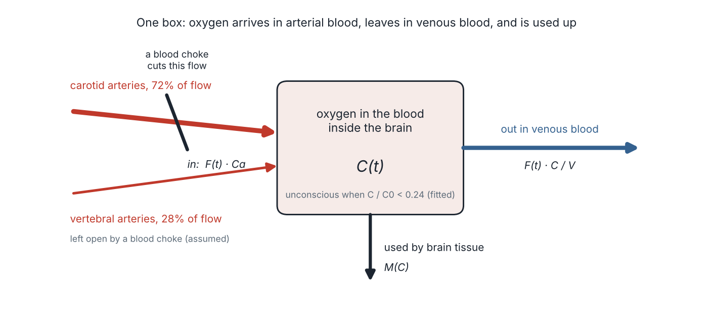
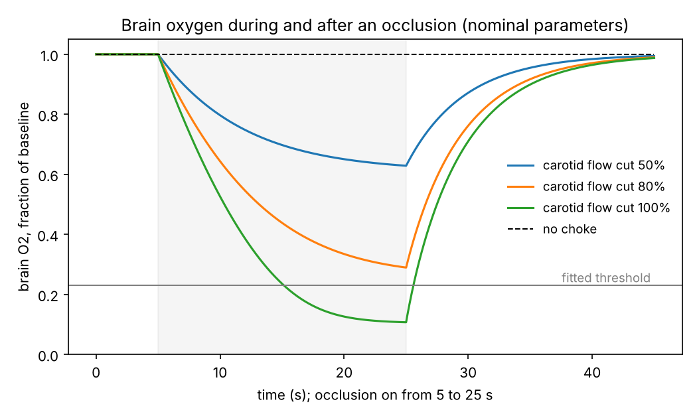
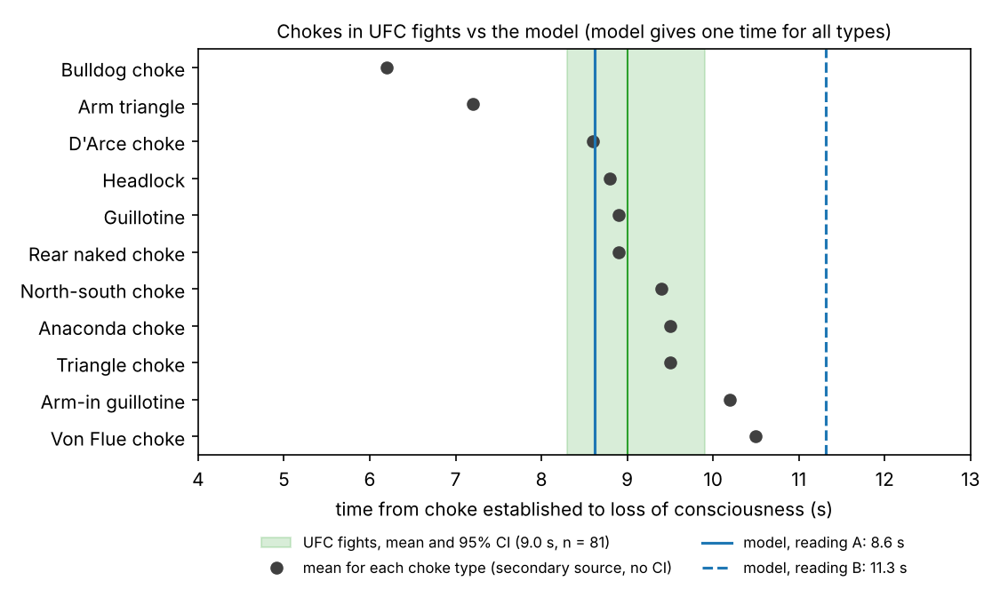
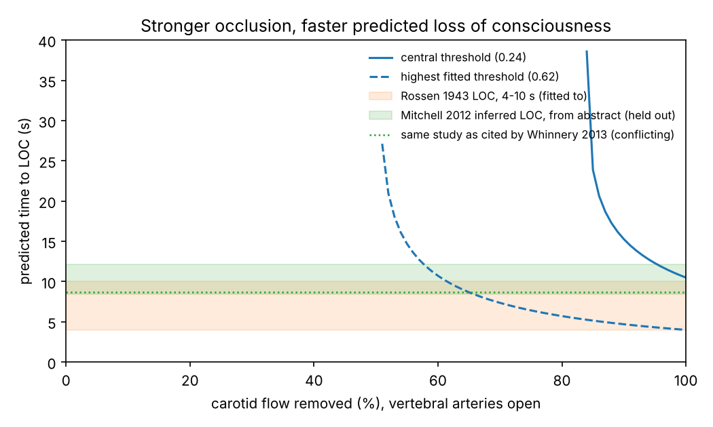
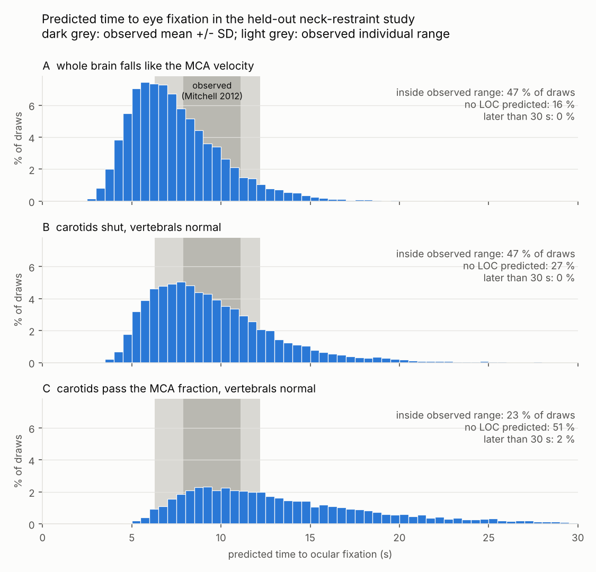
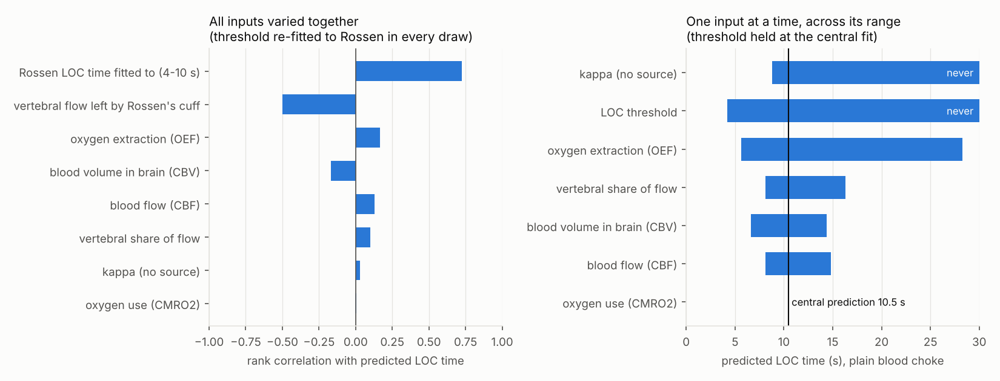
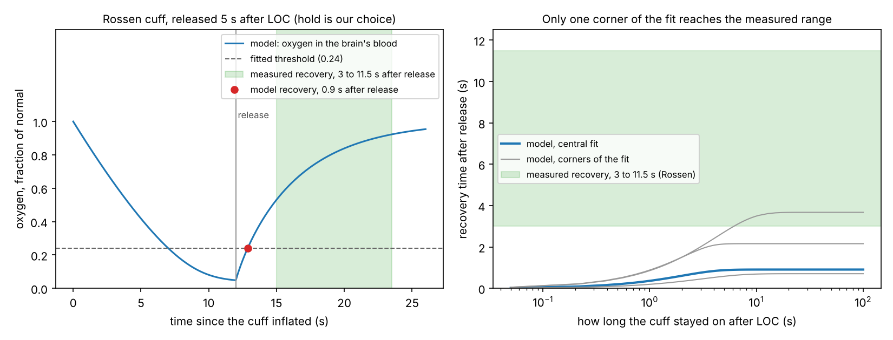

# Why does a blood choke cause unconsciousness in seconds?

> **Educational modelling project only. This is not medical advice and must not
> be used for safety, training or medical decisions.** It describes physiology
> and a model. It gives no guidance on applying chokes or strikes.

A small computer model of the oxygen in the brain's blood while the arteries
in the neck are squeezed shut, checked against published measurements,
including chokes timed in UFC fights. It is **not** a simulation of neurons,
and it does not claim to explain consciousness. It asks a narrower question
and reports where the answer holds and where it fails.

**In one paragraph.** The model is one equation with five measured inputs.
Its one free number, the oxygen level at which consciousness is lost, is
fitted to a 1943 experiment. With that number fixed, it was tested on data
it had never seen. It lands inside the measured interval for 81 chokes timed
in UFC fights (model 8.6 s, measured mean 9.0 s), and it gets a 2012
laboratory study right to within about one and a half seconds. It then
**fails** a recovery test outright: it says a person wakes within 1.0 s of
release, and the people measured took 3 to 11.5 s. Both the pass and the fail
are reported below with the same weight.

## The question

When the carotid arteries are compressed, people lose consciousness after
about 4 to 10 seconds (Rossen 1943, S1/S2). Is that timing what you would
expect from the simplest possible bookkeeping of oxygen, using only measured
values for blood flow, blood volume and oxygen use? Or does the timing need
something more than oxygen running out?

## The model



One box holds the oxygen carried by the blood that is inside the brain,
C(t). Oxygen arrives in arterial blood, leaves in venous blood, and is used
by the tissue:

$$\frac{dC}{dt} \;=\; F(t)\,C_a \;-\; F(t)\,\frac{C}{V} \;-\; M(C)$$

| Symbol | Meaning | Value | From |
|---|---|---|---|
| F | blood flow through the brain | 44.4 ± 6.5 ml per 100 ml per minute | Ito 2004 (S5) |
| V | blood volume inside the brain | 3.8 ± 0.7 ml per 100 ml | Ito 2004 (S5) |
| M | oxygen use at rest | 3.3 ± 0.5 ml O2 per 100 ml per minute | Ito 2004 (S5) |
| OEF | share of arriving oxygen that is extracted | 0.44 ± 0.06 | Ito 2004 (S5) |
| vertebral share | share of flow that does not come through the carotids | 0.28 ± 0.04 | Zarrinkoob 2015 (S9) |
| Ca | oxygen carried per ml of arterial blood | 0.1689 ml, derived from the rows above | Fick principle (A8) |
| κ | how sharply oxygen use falls when oxygen runs low | 0.1 nominal, sampled from 0.01 to 0.5 | **no source** (A5) |
| θ | level of C, as a fraction of normal, below which the model says "unconscious" | 0.2411, fitted | fitted to Rossen 1943 (A6) |

A choke is modelled as a cut in F: the carotid part of the flow is removed
and the vertebral part is left alone (A4). The store of oxygen divided by the
rate of use is 6.54 s, which is why the timescale is seconds.

**The threshold θ is the weakest part.** No source we could open gives the
oxygen level at which consciousness is lost, so θ is chosen to reproduce the
1943 timing. Because that experiment's cuff may or may not have closed the
vertebral arteries, the fit is a range, 0.0011 to 0.6179, with 0.2411 as the
central value. Everything below carries that range.

All 15 assumptions are listed in [ASSUMPTIONS.md](ASSUMPTIONS.md), and the
physiology is explained in plain English in [PHYSIOLOGY.md](PHYSIOLOGY.md).

## Results

Every number here is printed by a script into `results/`, and every figure
is drawn by a script into `figures/`. A test (`tests/test_readme.py`) fails
if this file states a number that the scripts did not produce.



### What the model was fitted to

| Data | Measured | Model |
|---|---|---|
| Rossen 1943, cuff around the neck | unconscious after 4 to 10 s | matches by construction, so this is **not evidence** |

### What it was tested on (not used in the fit)

The model needs to know how much blood flow is left during a choke. The 2012
study measured blood velocity in one pair of brain arteries, not flow to the
whole brain, so that measurement is read three ways (A11) and all three are
reported:

- **A**: the whole brain's flow falls as far as the measured velocity.
- **B**: the carotids are shut and the vertebrals carry their normal flow.
- **C**: the carotids pass the measured fraction and the vertebrals carry
  their normal flow.

| Test | Measured | A | B | C |
|---|---|---|---|---|
| 1. Mitchell 2012, 16 people who lost consciousness: time until the eyes became fixed | 9.5 ± 1.6 s | 7.9 s (gap -1.6 s) | 10.6 s (gap +1.1 s) | never |
| 2. Mitchell 2012, 4 people who stayed conscious for 23.3 s | no loss of consciousness | never: agrees | not applicable | never: agrees |
| 3. Stellpflug 2020, 81 chokes in UFC fights, timed from video | mean 9.0 s, 95% interval 8.3 to 9.9 s | 8.6 s: inside | 11.3 s: outside | never |
| 4. Lowest flow that never causes unconsciousness, as a share of normal | 0.44 (Claassen 2021), 0.50 (Njemanze 1992, second-hand) | 0.40, any reading | | |

Reading C predicts that nobody loses consciousness, which the measurements
contradict, so C is the reading the data argue against. A and B straddle the
laboratory result. A lands inside the UFC interval and B does not.



The model gives **one** time for every type of choke. No source we could open
measures how much each choke squeezes each artery, so there is nothing to
give different chokes different inputs (A14). The times for single choke
types in the figure come from second-hand write-ups of the study, without
ranges.



### How sure is it?

The single predictions above use central values. Stage 4 draws all inputs
from their published ranges 20000 times (seed 2026) and reruns the fit and
the tests each time.

- For a plain blood choke, the model predicts unconsciousness after a median
  of 8.7 s (5 to 95% of draws: 5.1 to 16.2 s), and in 26.6 % of draws it
  predicts that it never happens.
- The prediction falls inside the range measured in the 2012 study in
  47.4 % of draws for readings A and B, and 23.0 % for C.
- It gets **both** groups in that study right (the 16 who went out and the 4
  who did not) in 32.8 % of draws under reading A and 19.8 % under C.

So the central prediction is close, but the model is not sharp. Most of the
spread comes from the fitted threshold: its rank correlation with the
predicted time is -0.78, far more than any measured input.




### Where it fails: waking up

Recovery uses the same threshold crossed the other way (A15), with nothing
refitted.

| | Measured | Model |
|---|---|---|
| Time from release until consciousness returns (Rossen 1943) | 3 to 11.5 s | 0.2 to 1.0 s |

The model is too fast by 2.0 to 11.3 s. Across 5000 draws of the inputs,
even the slowest recovery the model can produce reaches the fastest measured
time in only 17.2% of draws, and the slowest measured time in 0.0%. Oxygen
returning to the blood is not enough to explain how long people take to wake
up. The model has no delay between oxygen returning and consciousness
returning, and none was added, because there is no second timed data set to
test one on.



## Limitations

- **The threshold is fitted, not measured,** and its range is wide (0.0011
  to 0.6179). The model's good central agreement depends on it.
- **It fails recovery.** See above. The model should not be used to say
  anything about what happens after release.
- **The flow left during a choke is not known.** It is read three ways, and
  the answer depends on the reading (8.6 s against 11.3 s in the UFC test).
  For fights it is borrowed from a laboratory study, because nobody has
  measured blood flow during a fight.
- **One constant has no source.** κ, which sets how oxygen use falls as
  oxygen runs out, is a guess sampled over a wide range (A5).
- **The brain is one well-mixed box.** No regions, no neurons, no blood
  pressure response, no change in heart rate, no autoregulation (A1, A10).
  The sources say the wait for consciousness is short; the model cannot say
  why consciousness depends on oxygen.
- **It cannot tell one choke from another,** and anything that works by
  closing the airway instead of the arteries is outside it.
- **Small samples and old data.** The fit rests on a 1943 experiment known
  here through a reprint and a review, and the held-out laboratory test has
  16 and 4 people.
- **Some sources were only partly opened** (abstract only for the flow and
  volume values and for the UFC study). Each entry in SOURCES.md says how
  much of it was read, and the gaps are listed at the end of that file.

## Run it

```
pip install -r requirements.txt
pytest
python -m scripts.stage2_model        # fit the threshold
python -m scripts.stage3_check        # held-out laboratory tests
python -m scripts.stage4_uncertainty  # Monte Carlo, about 3 minutes
python -m scripts.stage5_recovery     # recovery, about 2 minutes
python -m scripts.ufc_check           # chokes timed in UFC fights
python -m scripts.make_diagram        # the diagram above
python -m scripts.build_simulator     # the two pages below
```

Dependencies: numpy, scipy, matplotlib, pytest. GitHub Actions runs the
tests on every push.

## See it

Two pages, built from the same parameters as the Python model. A test checks
their JavaScript copy of the equation against the Python one.

- `simulator/xray.html`: a see-through 3D head you can rotate. Compress the
  carotids and watch flow stop and the front of the brain go dark at the
  time the model predicts, with the UFC choke times beside it. The anatomy
  is a published 3D model used as a picture only (BodyParts3D, CC BY 4.0,
  see [THIRD_PARTY.md](THIRD_PARTY.md)); what in that picture is model
  output and what is illustration is listed in A13 and on the page. The 3D
  view loads three.js from a CDN, so it needs an internet connection;
  without it the page shows a flat hand-drawn side view.
- `simulator/index.html`: sliders and an oxygen trace.

## Sources

Every parameter and every measured value comes from a published source that
was opened while building this, with the exact text quoted, in
[SOURCES.md](SOURCES.md). Where sources disagree or give a range, the range
is kept. The main ones:

- Rossen, Kabat and Anderson 1943, through a reprint and a review (S1, S2):
  time to loss of consciousness and to recovery with a neck cuff.
- Mitchell and others 2012 (S3): blood velocity and time to eye fixation
  during neck restraint.
- Ito and others 2004 (S5): flow, blood volume, oxygen extraction and oxygen
  use in healthy brains.
- Zarrinkoob and others 2015 (S9): how flow is shared between the carotid
  and vertebral arteries.
- Stellpflug and others 2020 and 2022 (S12, S13): chokes in UFC fights.
- Claassen and others 2021 (S4): the flow below which brain function fails.

## More

- [EXPLAIN.md](EXPLAIN.md): the project in plain English.
- [ASSUMPTIONS.md](ASSUMPTIONS.md), [PHYSIOLOGY.md](PHYSIOLOGY.md),
  [SOURCES.md](SOURCES.md), [THIRD_PARTY.md](THIRD_PARTY.md).
